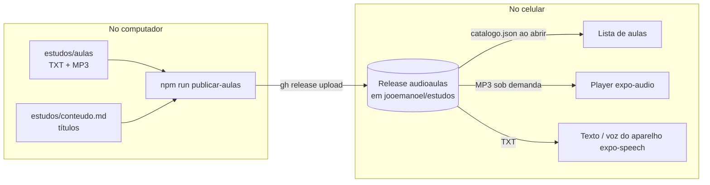

# Audioaulas (mobile)

App Android/iOS (React Native + Expo SDK 58) para ouvir as **audioaulas de estudo para o concurso da CGU**.
O APK é leve: os áudios ficam na release [`audioaulas`](https://github.com/jooemanoel/estudos/releases/tag/audioaulas) do repositório **estudos** e o app baixa cada aula quando você pedir, para ouvir **offline**.

- Player com tela de bloqueio, áudio em segundo plano, ±15/30 s, barra de posição e velocidade de 0,8x a 2x.
- Continua de onde parou em cada aula; marca aulas concluídas.
- Mostra o texto da aula junto com o áudio.
- Aulas sem MP3 (ou ainda não baixadas) podem ser ouvidas com a **voz do aparelho**, parágrafo a parágrafo, com o trecho lido destacado.
- Aulas novas aparecem sozinhas: o app busca o `catalogo.json` da release ao abrir, sem precisar de APK novo.

## Como funciona



## Publicar aulas novas

1. Coloque o TXT (e o MP3, se houver) em `estudos/aulas`, no padrão `aula_<item>_<nome>[_parteN][_roteiro_audio].txt` e `.mp3` com o mesmo nome.
2. Rode:

   ```
   npm run publicar-aulas
   ```

   O script gera o catálogo (títulos tirados do `conteudo.md`), cria a release se não existir e envia **só** os arquivos novos ou que mudaram de tamanho. O `catalogo.json` vai por último.
3. No app, a aula aparece ao abrir (ou em **Atualizar lista**).

Para só regenerar o catálogo embutido no app (`src/catalogo.json`), sem enviar nada: `npm run catalogo`.

## Estrutura

```
App.js                       lista ↔ aula, mini player, atualização do catálogo
src/estado/useReprodutor.js  player do MP3 (expo-audio) e leitura em voz (expo-speech); salva a posição
src/estado/useDownloads.js   fila de downloads com progresso e cancelamento
src/estado/useProgresso.js   progresso por aula, última aula e velocidade (progresso.json)
src/servicos/armazenamento.js URLs da release, arquivos no aparelho, catálogo e textos
src/nucleo/formatos.js       funções puras (tempo, MB, parágrafos, agrupamento), testadas em test/
src/telas/Lista.js           aulas por seção do edital, downloads, "Continuar"
src/telas/Aula.js            player, velocidade, texto, concluída, excluir áudio
scripts/catalogo.js          gera src/catalogo.json a partir de estudos/aulas
scripts/publicar-aulas.js    envia as aulas para a release audioaulas
```

## Desenvolvimento

```
npm install
npm test          # testes das funções puras e do gerador de catálogo
npm run lint
npm run apk:local # APK de release em android/app/build/outputs/apk/release
```

O build local usa o plugin `plugins/cmake-recente.js` (CMake 3.31.6) por causa do limite de 260 caracteres nos caminhos do Windows.

## Limitações

- A leitura com a voz do aparelho depende do motor de voz instalado (Google, Samsung...) e é controlada pelo app: a tela fica ligada enquanto lê. Para ouvir com a tela apagada, use o MP3.
- Os áudios baixados ficam na pasta interna do app: desinstalar o app apaga os áudios e o progresso.
